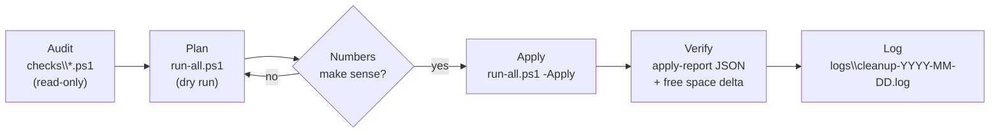

# PC Cleanup Kit

**Audit-first Windows cleanup.** A micro-modular PowerShell kit that inventories what occupies your disk, tells you exactly what each item is and what it costs to lose, removes only what you approve, and writes a verifiable report of every run.


> **Nothing is deleted unless you pass `-Apply`.** No elevation, no telemetry, no network calls, no installers. Plain scripts you can read in a few minutes.

---

## Table of contents

- [What it does](#what-it-does)
- [Why another cleaner](#why-another-cleaner)
- [Requirements](#requirements)
- [Quick start](#quick-start)
- [How a cleanup run works](#how-a-cleanup-run-works)
- [Tiers](#tiers)
- [Cleanup catalog](#cleanup-catalog)
- [Safety model](#safety-model)
- [Command reference](#command-reference)
- [Tests](#tests)
- [Project layout](#project-layout)
- [Adding your own cleanup group](#adding-your-own-cleanup-group)
- [Documentation](#documentation)
- [Privacy](#privacy)

---

## What it does

1. **Audit** — read-only checks measure your disk, your `AppData`, your whole drive, and what starts by itself (startup entries, services, scheduled tasks, packaged apps).
2. **Plan** — every cleanup target is a declarative *group*: fixed paths, a tier, a size estimate, the reason it is expendable, and how it rebuilds. Previewing a group prints what it will remove and how big it is.
3. **Apply** — a single `-Apply` switch turns a preview into deletion, group by group, with a timestamped log.
4. **Verify** — each run writes `data\apply-report-<timestamp>.json` (free space before/after, tiers selected, per-group MB, applied flag) so you or another agent can confirm what actually happened.

It ships with **31 cleanup groups** in three risk tiers, backed by 84 PowerShell files that each do one thing.

## Why another cleaner

Most "cleaner" tools are either opaque (one big binary, no idea what it touched) or over-eager (registry "optimisation", service disabling, telemetry hacks). This kit is deliberately narrow:

| | Typical cleaner | PC Cleanup Kit |
|---|---|---|
| Default action | Deletes immediately | **Dry run** — deletes only with `-Apply` |
| Scope | Registry, services, tasks, "privacy" | **Files in known cache/temp locations only** |
| Explanation | None | Every group documents why it is safe and how it regenerates |
| Verification | "Cleaned 4.2 GB" | JSON report with before/after free space and per-group sizes |
| Extensibility | Closed | One file per group; add your own in ~15 lines |
| Dependencies | Bundled binary, installer | PowerShell 5.1, built into Windows |

It will **not** touch documents, installed programs, browser profiles, credentials, WPS data, `WinSxS`, `Windows\Installer`, `pagefile.sys` or `hiberfil.sys`. Those are listed explicitly in [`docs/04-never-touch.md`](docs/04-never-touch.md).

## Requirements

- Windows 10 or 11
- Windows PowerShell 5.1 (built in) — no PowerShell 7 required, no modules to install
- Execution policy bypass for the session: every example below uses `-ExecutionPolicy Bypass -File`
- Elevation only for the `system` tier (Windows temp, update cache, delivery optimization, machine-wide installers). The kit never elevates itself; it detects the lack of admin rights and degrades gracefully.

## Quick start

```powershell
git clone https://github.com/dr-week/PC-cleanup-kit-.git
cd PC-cleanup-kit-\scripts

# 1. look first (read-only)
powershell -NoProfile -ExecutionPolicy Bypass -File checks\show-space.ps1
powershell -NoProfile -ExecutionPolicy Bypass -File checks\measure-targets.ps1
powershell -NoProfile -ExecutionPolicy Bypass -File checks\audit-machine.ps1

# 2. preview every safe target — nothing is deleted
powershell -NoProfile -ExecutionPolicy Bypass -File run-all.ps1

# 3. delete the safe targets
powershell -NoProfile -ExecutionPolicy Bypass -File run-all.ps1 -Apply
```

One group at a time:

```powershell
powershell -NoProfile -ExecutionPolicy Bypass -File clean\clean-npm-cache.ps1          # preview
powershell -NoProfile -ExecutionPolicy Bypass -File clean\clean-npm-cache.ps1 -Apply   # delete
```

## How a cleanup run works



`run-all.ps1` selects groups by tier, runs them in catalog order, prints a size-sorted summary, and records the result:

```json
{
  "generated": "2026-11-24T10:30:01",
  "computer": "WORKSTATION",
  "apply": false,
  "tiers": ["safe"],
  "freeBeforeMB": 145603.9,
  "freeAfterMB": null,
  "totalMB": 685.6,
  "groups": [
    { "Id": "updaters", "Tier": "safe", "MB": 562.5, "Applied": false }
  ]
}
```

## Tiers

| Tier | Included by default | What it is | Est. on the reference machine |
|---|---|---|---|
| `safe` | yes | Regenerated application caches and leftovers inside `%LOCALAPPDATA%` / `%APPDATA%`. No documents, settings or profiles. | ≈ 30.7 GB |
| `optional` | no — `-IncludeOptional` | Re-downloadable developer/OEM payloads: build caches, package stores, runtime downloads, OEM driver backup. Deleting costs time, not data. | ≈ 15.2 GB |
| `system` | no — `-IncludeSystem` | Drive-level Windows junk: temp folders, update caches, WER dumps, Recycle Bin, leftover NVIDIA/WPS installers, `Windows.old`. Usually needs an elevated shell. | ≈ 14.2 GB |

Estimates come from one heavily used workstation (sizes in the catalog are static). Run `checks\measure-targets.ps1` to measure your own machine.

## Cleanup catalog

31 groups, one file each in `scripts\_lib\catalog\groups\`. `Mode` is how the group is emptied: `remove` deletes the tree, `clear` empties the contents but keeps the folder, `command` uses a built-in API (Recycle Bin).

### Safe — included in `run-all.ps1`

| Group | What it is | Mode | Est. |
|---|---|---|--:|
| `adobe-media-cache` | Adobe media cache and `.pek`/`.cfa` peak files | remove | 6.8 GB |
| `npm-cache` | npm download cache | remove | 6.1 GB |
| `chrome-ondevice-model` | Chrome on-device AI model and classifier blobs | remove | 4.1 GB |
| `pnpm-store` | pnpm content-addressable store | remove | 3.5 GB |
| `updaters` | Electron auto-updater leftovers (Squirrel/`*-updater` caches) | remove | 3.2 GB |
| `vscode-caches` | VS Code / Insiders caches | remove | 2.9 GB |
| `ms-playwright` | Playwright browser binaries | remove | 2.0 GB |
| `adobe-extra` | Adobe caches, templates, font caches, logs | remove | 1.1 GB |
| `pip-cache` | pip wheel cache | remove | 0.4 GB |
| `package-cache` | Visual Studio installer package cache | remove | 0.4 GB |
| `temp` | User `%TEMP%` contents | clear | 0.15 GB |
| `crash-dumps` | Application crash dumps | clear | 0.1 GB |

### Optional — `-IncludeOptional`

| Group | What it is | Mode | Est. |
|---|---|---|--:|
| `esupport-drivers` | OEM factory driver backup (`C:\eSupport`) | remove | 6.3 GB |
| `gradle-cache` | Gradle caches and wrapper distributions | remove | 3.5 GB |
| `codex-runtimes` | Codex / Codebuff runtime downloads | remove | 1.9 GB |
| `bun-cache` | Bun install cache | remove | 1.6 GB |
| `codex-appdata` | Codex application data | remove | 1.5 GB |
| `neo-cache` | NEO compiler cache | remove | 0.4 GB |

### System — `-IncludeSystem` (usually elevated)

| Group | What it is | Mode | Est. |
|---|---|---|--:|
| `nvidia-update-cache` | NVIDIA app downloaded driver installers | remove | 8.2 GB |
| `windows-update-cache` | Windows Update download cache | remove | 1.5 GB |
| `recycle-bin` | Recycle Bin (via `Clear-RecycleBin`) | command | 1.0 GB |
| `windows-temp` | Drive-level Windows temp folders | clear | 0.9 GB |
| `programdata-package-cache` | Machine-wide installer package cache | remove | 0.8 GB |
| `windows-logs` | Windows component / update logs | clear | 0.4 GB |
| `delivery-optimization` | Delivery Optimization cache | remove | 0.4 GB |
| `wps-installers` | WPS Office installer cache | remove | 0.3 GB |
| `windows-error-reports` | Windows Error Reporting queues and memory dumps | remove | 0.3 GB |
| `nvidia-installer-files` | Leftover NVIDIA installer files | remove | 0.3 GB |
| `edge-update-download` | Microsoft Edge updater downloads | remove | 0.1 GB |
| `windows-prefetch` | Prefetch cache | clear | 0.05 GB |
| `windows-old` | Previous Windows installation (`C:\Windows.old`) | remove | *detected* |

## Safety model

1. **Dry run is the default.** `-Apply` is required to delete anything, on every wrapper and on `run-all.ps1`.
2. **Two deletion functions, both isolated** in `scripts\_lib\core\remove.ps1`. Nothing else in the kit deletes files.
3. **Declarative targets.** A group can only touch the literal paths in its own file after `%ENV%` expansion — no registry sweeps, no "search and destroy".
4. **Never-touch list is explicit** (`docs/04-never-touch.md`): programs, browser profiles, WPS data, credentials, documents, Downloads, `WinSxS`, `Windows\Installer`, `pagefile.sys`, `hiberfil.sys`.
5. **Every action is logged** to `logs\cleanup-YYYY-MM-DD.log`, and every full run writes a machine-readable report to `data\`.
6. **No elevation by itself.** Groups that need admin rights fail softly and say so.
7. **Startup-entry removal backs up first.** `clean\clean-startup-entry.ps1` saves the value, removes one named entry, then verifies it is gone.

## Command reference

### Audits and reports (read-only)

| Script | Output |
|---|---|
| `checks\show-space.ps1` | Drive free space + top `AppData` consumers |
| `checks\measure-targets.ps1` | Live sizing of every group → `data\scan-live.json` / `.csv` |
| `checks\scan-drive.ps1` | Whole-drive scan → `data\scan-drive-<date>.json` / `.csv` |
| `checks\find-unwanted.ps1` | Junk-name candidates from the drive scan |
| `checks\audit-machine.ps1` | Startup entries, services, scheduled tasks, packaged apps, AI components → `data\audit-<date>.json` / `.csv` |

### Cleaning

| Command | Effect |
|---|---|
| `run-all.ps1` | Preview all `safe` groups |
| `run-all.ps1 -Apply` | Delete all `safe` groups |
| `run-all.ps1 -Apply -IncludeOptional` | + developer/OEM payloads |
| `run-all.ps1 -Apply -IncludeSystem` | + drive-level Windows junk (elevated shell recommended) |
| `clean\clean-<id>.ps1 [-Apply]` | One named group |
| `clean\clean-startup-entry.ps1 -Name '<value>' -Scope HKCU\|HKLM\|HKLM-Wow64 [-Apply]` | One named startup value, with backup |

Exit codes: `0` success, non-zero on failure. Tests return the number of failed suites.

## Tests

```powershell
powershell -NoProfile -ExecutionPolicy Bypass -File tests\run-tests.ps1
```

| Suite | Asserts |
|---|---|
| `test-syntax.ps1` | Every `.ps1` parses (AST only, nothing executed) |
| `test-catalog.ps1` | Every group is well-formed, has a wrapper, and file name matches id |
| `test-data.ps1` | Local scan snapshots are valid and consistent with the catalog (skips on a fresh clone) |
| `test-audit.ps1` | The audit runs against a temp file and writes valid JSON + CSV |
| `test-runall.ps1` | Actually runs `run-all.ps1` dry three ways and validates the resulting `apply-report-*.json` |

## Project layout

```
PC-cleanup-kit/
├── README.md                       this file
├── AGENTS.md                       operating rules for AI agents / contributors
├── docs/                           10 numbered documents (see below)
├── data/                           local output: scans, audits, apply reports (git-ignored)
├── logs/                           local output: cleanup-YYYY-MM-DD.log (git-ignored)
└── scripts/
    ├── run-all.ps1                 tier selector + summary + apply report
    ├── _lib/
    │   ├── bootstrap.ps1            the single entry point; loads everything below
    │   ├── runner.ps1               Invoke-CleanGroup (one group, dry by default)
    │   ├── core/
    │   │   ├── paths.ps1            kit layout, log path
    │   │   ├── log.ps1              console/log output, size formatting
    │   │   ├── scan.ps1             fast .NET tree measurement, large-file list
    │   │   ├── size.ps1             folder size, free space
    │   │   ├── targets.ps1          %ENV% and wildcard expansion
    │   │   └── remove.ps1           the only deleting functions
    │   └── catalog/
    │       ├── index.ps1            loads groups\*.ps1 → Get-CleanupCatalog
    │       └── groups/              31 groups, one file per group
    ├── checks/                      5 read-only audits
    ├── clean/                       31 group wrappers + clean-startup-entry.ps1
    └── tests/                       run-tests.ps1 + 5 suites
```

## Adding your own cleanup group

One file, one wrapper, one doc row — no shared file to edit.

```powershell
# scripts\_lib\catalog\groups\my-cache.ps1
@{
    Id      = 'my-cache'
    Title   = 'My app scratch cache'
    Tier    = 'safe'                       # safe | optional | system
    Mode    = 'remove'                     # remove | clear | command
    EstMB   = 0
    Paths   = @('%LOCALAPPDATA%\MyApp\Cache')
    Why     = 'Rebuilt on demand; holds only derived files.'
    Recover = 'Reopen MyApp to regenerate.'
    Caveat  = 'Close MyApp first.'
}
```

```powershell
# scripts\clean\clean-my-cache.ps1
#requires -Version 5.1
param([switch]$Apply)
. "$PSScriptRoot\..\_lib\bootstrap.ps1"
Invoke-CleanGroup -Id 'my-cache' -Apply:$Apply
```

Then run `tests\run-tests.ps1` — the catalog suite fails if the id, file name or wrapper do not line up.

## Documentation

| Document | Contents |
|---|---|
| [`01-scan-summary.md`](docs/01-scan-summary.md) | Where the space actually goes |
| [`02-safe-to-delete.md`](docs/02-safe-to-delete.md) | The safe tier in detail |
| [`03-review-before-delete.md`](docs/03-review-before-delete.md) | Optional tier + items needing a human decision |
| [`04-never-touch.md`](docs/04-never-touch.md) | Programs, profiles, credentials, system files |
| [`05-cleanup-procedure.md`](docs/05-cleanup-procedure.md) | Exact run order |
| [`06-risks-and-recovery.md`](docs/06-risks-and-recovery.md) | What breaks and how it comes back |
| [`07-architecture.md`](docs/07-architecture.md) | Module-by-module design |
| [`08-drive-wide.md`](docs/08-drive-wide.md) | Drive-wide scanning and the system tier |
| [`09-drive-findings.md`](docs/09-drive-findings.md) | Findings from a full-drive scan |
| [`10-machine-audit.md`](docs/10-machine-audit.md) | Startup/services/tasks/AI audit |

## Privacy

- **No network calls.** Nothing is uploaded, downloaded or phoned home.
- **`data/` and `logs/` are git-ignored.** They contain absolute paths and an inventory of installed software from the machine that produced them, so they stay local. A fresh clone has none; the data suite skips instead of failing.
- **No secrets are read.** The kit never opens browser profiles, credential stores or configuration files with tokens.
